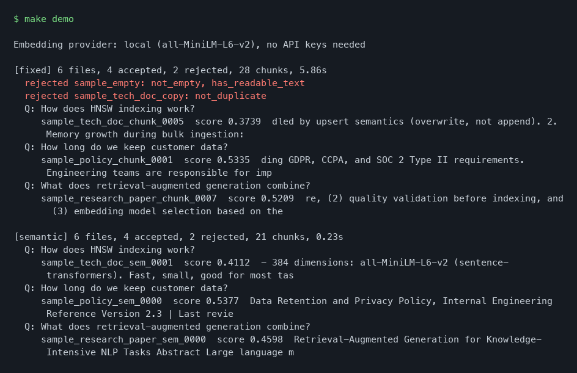
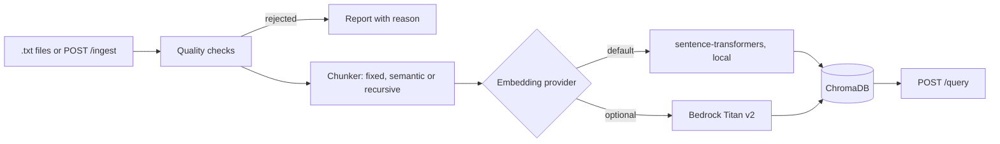

# RAG Document Pipeline

Ingests text documents into a vector store for retrieval: quality checks, three chunking strategies, local or Bedrock embeddings, ChromaDB, a FastAPI service. A personal project for people who want to see the ingestion side of RAG without a framework hiding it.

**Topics:** `rag`, `retrieval-augmented-generation`, `chromadb`, `sentence-transformers`, `fastapi`, `embeddings`, `document-chunking`, `python`



## Results

All numbers come from scripts in this repo. Raw output is in `results/`.

**Load test.** 50,000 articles of Simple English Wikipedia (77.7 MB of text), local `all-MiniLM-L6-v2` embeddings, fixed-size chunks, ChromaDB on disk.

```bash
make corpus     # one-time download, about 157 MB, stored outside the repo
make loadtest   # /usr/bin/time -l python scripts/load_test.py --n 50000 --strategy fixed
```

| Measure | Value |
|---|---|
| Articles read | 50,000 (49,499 accepted, 501 rejected: 468 mostly symbols or numbers, 33 too short) |
| Chunks stored | 125,136 |
| Wall time | 695 s (11.6 min), 72 articles per second, 180 chunks per second |
| Peak memory | 749 MB resident (`/usr/bin/time -l`) |
| Query latency, top 5 | p50 11.9 ms, p95 15.7 ms (100 queries, after loading) |

Machine: Apple M4, 16 GB, shared with other jobs; embeddings ran on the Apple GPU (MPS). Earlier runs took 585 s and 816 s, so the time is one measurement. No CPU-only run.

**Chunking comparison.** 3,000 articles indexed per strategy, 1,000 questions. A question is a sentence from an article ("verbatim") or the same sentence with 40 percent of its words removed ("dropout"). A hit means a top-5 chunk from the right article that contains at least 80 percent of the sentence's words.

```bash
make eval       # python scripts/compare_chunking.py --docs 3000 --queries 1000
```

| Strategy | Chunks | Verbatim hit@1 | Verbatim hit@5 | Dropout hit@1 | Dropout hit@5 |
|---|---|---|---|---|---|
| fixed (1000 chars, 200 overlap) | 16,466 | 0.521 | 0.691 | 0.340 | 0.499 |
| semantic (paragraph and sentence) | 12,823 | 0.536 | 0.679 | 0.360 | 0.519 |
| recursive (LangChain splitter) | 17,725 | 0.554 | 0.707 | 0.350 | 0.503 |

Reruns of this command moved individual numbers by about 2 points (the embedding model runs on the GPU), and with 1,000 questions differences of a few points are noise. The three strategies are within about 4 points of each other on every measure, so none clearly wins. Semantic gets similar hit rates with 22 percent fewer chunks to embed and store.

## How it works



Each document goes through quality checks first: length, share of letters, null bytes and replacement characters, and exact duplicates by hash. Accepted documents are chunked, embedded in batches and upserted into ChromaDB with cosine distance. Documents are processed 200 at a time, so memory follows the batch size and not the corpus size. A document whose chunking, embedding or storage fails is listed in `failed_doc_ids` and the run continues. `EMBEDDING_PROVIDER` picks the embedder; demo mode never imports the Bedrock code.

## Design choices

- **Quality checks before chunking.** Embedding is the slow step, so rejecting empty, symbol-heavy and duplicate documents first saves the most time. In the 50,000 article run it dropped 501 documents before they cost any embedding time.
- **"Semantic" means structure, not embeddings.** It splits on paragraphs and sentences and merges up to 1,200 characters. I considered splitting where embedding similarity drops, and kept the cheaper version because the comparison above shows little to gain from chunking alone on this corpus.
- **Batches of documents, not one big list.** The first version chunked the whole corpus into memory before embedding. Batches keep memory flat; the 50,000 article run peaked at 749 MB resident.
- **ChromaDB over a hosted vector database.** It runs in-process or as a container, so the demo needs no account. I did not benchmark past about 125,000 vectors.
- **LangChain for one thing.** I use its recursive text splitter as a reference strategy. The rest of the pipeline is plain Python so each step can be read and tested.

## Run it

Needs Python 3.12 or 3.13. The first run downloads the 90 MB embedding model. No API keys.

```bash
python3.13 -m venv .venv && . .venv/bin/activate   # or python3.12
pip install -r requirements-dev.txt
make demo
```

Or the API with Docker (ChromaDB server plus the FastAPI service, ports 8000 and 8001, override with `API_PORT` and `CHROMA_PORT`):

```bash
docker compose up -d --build
docker compose exec api python scripts/ingest_documents.py --strategy semantic
curl -s -X POST localhost:8000/api/v1/query -H 'Content-Type: application/json' \
  -d '{"query": "how does HNSW indexing work", "n_results": 3}'
docker compose down -v
```

Endpoints: `GET /api/v1/health`, `POST /api/v1/ingest` (`documents`, `chunk_strategy`, optional `metadata`), `POST /api/v1/query` (`query`, `n_results`, optional `filter_metadata`). Interactive docs at `/docs`.

To use Bedrock, set `EMBEDDING_PROVIDER=bedrock` and AWS credentials (see `.env.example`). I have not run this path against the live service. It is tested with a fake client, including the retry on throttling. Titan vectors have 1024 dimensions, so use a fresh collection.

## Tests

```bash
make test    # 83 tests, about 6 seconds, offline
make lint    # ruff
```

Tests run on the committed sample files in `data/samples` (including one empty file and one duplicate that must be rejected), the chunkers, the API through FastAPI's test client, and the evaluation helpers. Most use a hashing embedder so they need no model; one uses the real local model and skips itself if the model cannot be downloaded. CI runs lint, the tests and the demo on Python 3.12 and 3.13.

## What I'd do next

- Embedding-based semantic chunking, and measure it against the structure-based one.
- Hybrid search (BM25 plus vectors) and a reranker; the sentence-based questions above favour exact wording, so I would add human-written questions.
- Batch Bedrock calls in parallel; today they go one text at a time.
- Tune HNSW parameters and test beyond 125,000 vectors.
