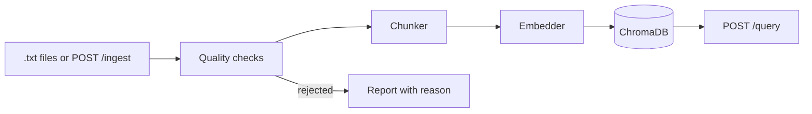

# RAG Document Pipeline

Ingests text documents into a vector store for retrieval: quality checks, three chunking strategies, local or Bedrock embeddings, ChromaDB, a FastAPI service. A personal project for people who want to see the ingestion side of RAG without a framework hiding it.

**Topics:** `rag`, `retrieval-augmented-generation`, `chromadb`, `sentence-transformers`, `fastapi`, `embeddings`, `document-chunking`, `python`


## Results

**Load test.** 50,000 Simple English Wikipedia articles (77.7 MB), local `all-MiniLM-L6-v2`, fixed chunks, ChromaDB on disk. Apple M4, 16 GB, one measurement. Command: `make corpus` (one-time), then `make loadtest`. Details in [docs/RESULTS.md](docs/RESULTS.md).

| Measure | Value |
|---|---|
| Articles read | 50,000 (49,499 accepted, 501 rejected: 468 mostly symbols or numbers, 33 too short) |
| Chunks stored | 125,136 |
| Wall time | 695 s (11.6 min), 72 articles per second, 180 chunks per second |
| Peak memory | 749 MB resident (`/usr/bin/time -l`) |
| Query latency, top 5 | p50 11.9 ms, p95 15.7 ms (100 queries, after loading) |

**Chunking comparison** (`make eval`). Fixed, semantic and recursive are within about 4 points of each other on every measure, so none clearly wins. Table and method: [docs/RESULTS.md](docs/RESULTS.md).

## How it works



- Quality checks run first: length, share of letters, null bytes and replacement characters, exact duplicates by hash.
- Accepted documents are chunked (fixed, semantic or recursive), embedded in batches and upserted with cosine distance.
- Documents go through 200 at a time, so memory follows the batch size and not the corpus size.
- A document that fails is listed in `failed_doc_ids` and the run continues.
- `EMBEDDING_PROVIDER` picks local sentence-transformers (default) or Bedrock Titan v2; demo mode never imports the Bedrock code.

## Design choices

- **Quality checks before chunking.** Embedding is the slow step; the 50,000 article run dropped 501 documents before they cost any embedding time.
- **"Semantic" means structure, not embeddings.** Paragraph and sentence splits merged up to 1,200 characters; the comparison shows little to gain from chunking alone on this corpus.
- **Batches of documents, not one big list.** The first version held the whole corpus in memory; batches keep it flat (749 MB peak).
- **ChromaDB over a hosted vector database.** It runs in-process or as a container, so the demo needs no account.
- **LangChain for one thing.** Its recursive splitter is a reference strategy; the rest is plain Python so each step can be read and tested.

## Run it

Needs Python 3.12 or 3.13. The first run downloads the 90 MB embedding model. No API keys.

```bash
python3.13 -m venv .venv && . .venv/bin/activate   # or python3.12
pip install -r requirements-dev.txt
make demo
```

Or the API with Docker (ChromaDB server plus the FastAPI service, ports 8000 and 8001, override with `API_PORT` and `CHROMA_PORT`):

```bash
docker compose up -d --build
docker compose exec api python scripts/ingest_documents.py --strategy semantic
curl -s -X POST localhost:8000/api/v1/query -H 'Content-Type: application/json' \
  -d '{"query": "how does HNSW indexing work", "n_results": 3}'
docker compose down -v
```

Endpoints: `GET /api/v1/health`, `POST /api/v1/ingest` (`documents`, `chunk_strategy`, optional `metadata`), `POST /api/v1/query` (`query`, `n_results`, optional `filter_metadata`). Interactive docs at `/docs`.

To use Bedrock, set `EMBEDDING_PROVIDER=bedrock` and AWS credentials (see `.env.example`). I have not run this path against the live service. It is tested with a fake client, including the retry on throttling. Titan vectors have 1024 dimensions, so use a fresh collection.

## Tests

```bash
make test    # 83 tests, about 6 seconds, offline
make lint    # ruff
```

Tests run on the committed sample files in `data/samples` (including one empty file and one duplicate that must be rejected), the chunkers, the API through FastAPI's test client, and the evaluation helpers. Most use a hashing embedder so they need no model; one uses the real local model and skips itself if the model cannot be downloaded. CI runs lint, the tests and the demo on Python 3.12 and 3.13.

## What I'd do next

- Embedding-based semantic chunking, and measure it against the structure-based one.
- Hybrid search (BM25 plus vectors) and a reranker; the sentence-based questions above favour exact wording, so I would add human-written questions.
- Batch Bedrock calls in parallel; today they go one text at a time.
- Tune HNSW parameters and test beyond 125,000 vectors.
